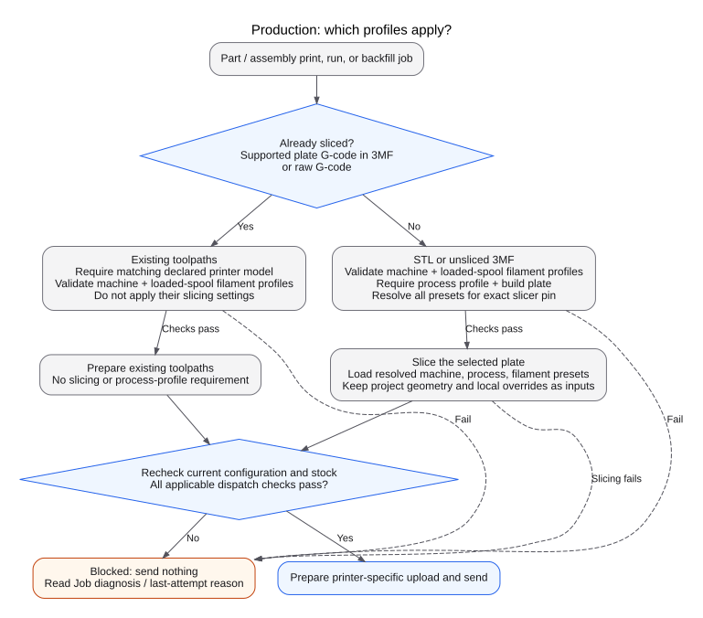

**Profiles generate new toolpaths only when the file needs slicing.** STL and unsliced 3MF need slicing. Supported sliced 3MF and raw G-code already contain toolpaths. Changing an OpenFarm profile does not regenerate those toolpaths.

There are two separate stages:

1. **Library processing** reads the uploaded file and, when supported, calculates estimates. It does not select settings from your connected printers or loaded spools.
2. **Production file preparation** checks the destination printer and its loaded spools. If slicing is needed, OpenFarm uses that printer's configuration and the part's saved slicer engine and exact version.

The saved engine and version are called the **slicer pin**. Pinning a job to a printer is a separate choice.

A successful estimate or **Ready to print** part does not guarantee that a particular printer can take the job. [Printer matching](../production/matching.md) still applies.

## What the three profiles mean

| Profile | Where you configure it for production | Role when slicing |
| --- | --- | --- |
| **Printer / machine** | Edit the destination printer → machine profile | Supplies machine settings, including machine G-code and nozzle configuration. OpenFarm also checks the registered hardware and the connected printer's nozzle report. |
| **Process** | Edit the destination printer → process profile | Supplies the process preset, such as layer height, walls, infill, and support defaults. |
| **Filament** | Edit the filament → assign a profile for the printer brand, model, and nozzle size. A color can override this assignment. | Supplies material settings for the tracked spool selected for each required material and color. |

A printer record describes physical hardware. A machine profile contains slicer settings. A spool record tracks a physical roll of filament. A filament profile contains material settings for the slicer. Selecting a profile does not change the physical nozzle, plate, or material.

## Which kind of file did I upload?

The `.3mf` extension alone does not answer this question. A 3MF archive can contain geometry, project settings, or sliced toolpaths. A project can also retain geometry and settings after slicing.

| File contents | OpenFarm's route |
| --- | --- |
| **STL** | Unsliced geometry; needs production slicing. |
| **Geometry-only 3MF** (sometimes called plain 3MF) | No supported plate G-code and no recognized embedded project settings; needs production slicing. |
| **Unsliced project 3MF** | No supported plate G-code, but contains project settings; needs production slicing even if OpenFarm successfully estimates it. |
| **Sliced 3MF**, often named `.gcode.3mf` | Contains a supported `Metadata/plate_*.gcode` entry. OpenFarm treats the upload as already sliced, even if it also contains project settings and models. |
| **Raw `.gcode`, `.gco`, or `.g`** | Already sliced. |

OpenFarm looks inside the 3MF archive for supported plate G-code. The `.gcode.3mf` filename alone does not select the file's processing route. Other vendors' 3MF layouts are not automatically supported. OpenFarm can reject malformed or unsupported files. Unreadable or conflicting metadata can leave requirements or estimates unknown.

If an archive contains supported plate G-code, OpenFarm processes the upload as already sliced. This also applies to archives that mix sliced and unsliced plates. OpenFarm does not automatically slice the remaining plates. A requested plate must have usable sliced output.

For background on the format, Prusa's [Saving projects as 3MF](https://help.prusa3d.com/article/saving-projects-as-3mf_1773) explains why a project can carry settings and modifiers as well as geometry. OpenFarm's own supported entries determine its behavior.

## During upload, replacement, or reprocessing

**Library estimates do not use the fleet's selected machine and process profiles or the inventory's filament-profile assignments.** There is no separate farm estimation profile to configure.

| Uploaded file | Source of library time and weight estimates | Are production profiles applied? |
| --- | --- | --- |
| STL or geometry-only 3MF | No automatic slicing estimate. Complete missing requirements during review; estimates remain unavailable. | No. |
| Supported unsliced project 3MF | OpenFarm first runs the selected slicer with the project's embedded settings. See the restricted retry below. | No; the destination printer and loaded spools are not selected here. |
| Sliced 3MF or raw G-code | Metadata already present in the file. OpenFarm does not run the slicer to recalculate it. | No. |

Missing time or weight stays unknown. It does not become zero. If an estimate fails, you can still save a part after reviewing its requirements. Production still needs complete requirements.

### Project settings and the named-preset retry

OpenFarm can estimate recognized OrcaSlicer and Bambu Studio projects from their embedded settings. The settings must be usable, and the selected slicer engine and version must be available. This estimation mode excludes Bambu Studio **2.7.1 on macOS**. It does not support Prusa or Cura project settings.

The first attempt loads the project without external machine, process, or filament preset files. A second attempt is available only for specific validation, version, or modified-machine errors. For this second attempt, OpenFarm:

1. Reads the machine, process, and filament preset names and the build plate stored in the project.
2. Looks up each preset by name in the **selected engine's exact version catalog**. Each name must have exactly one match.
3. Checks that the build plate is recognized and the matched presets are compatible.
4. Retries with those catalog presets.

This retry replaces the project's global preset settings. It does not reproduce custom edits to those presets. Project geometry and local settings remain inputs to the slicer.

The retry requires **one distinct nonblank filament preset name**. Several slots can share that name. A project with several different filament presets can succeed on the first attempt. It cannot use this retry.

Missing presets, multiple matches, or another slicing failure leave the estimate unavailable. This retry does not select your fleet's production profiles. Production dispatch does not use this retry as a fallback.

### Estimating does not make the source file pre-sliced

For an unsliced upload, the toolpath generated for estimation is temporary. OpenFarm saves the estimates and thumbnails, then discards that toolpath. It slices the stored source again when preparing a production job.

## When a job is prepared for a printer

Direct part printing, assembly printing, runs with fixed quantities, and continuous backfill all create queue work. They use the same file preparation and dispatch checks. Pinning a job restricts it to one printer. It does not bypass those checks.

### STL and unsliced 3MF: generate a new production file

For each destination printer, OpenFarm:

1. Checks that the job's requirements are complete and current printer reports confirm the nozzle size.
2. Checks the machine profile and finds matching tracked spools on active feed paths.
3. Selects each spool's filament-profile assignment for that printer hardware and nozzle size. A color override takes priority over the filament default.
4. Requires the printer's **machine profile, process profile, and build plate**, plus the job's **exact slicer engine and version pin**.
5. Finds compatible presets and their inherited settings in the pinned catalog.
6. Checks each required filament separately, including its bed-temperature setting for the selected plate.
7. Supplies those presets to the slicer and slices the part's selected project plate.
8. Rechecks the current configuration and stock before sending.

If a check or slicing fails, OpenFarm sends nothing. A profile constraint saved on a part or job must agree with the loaded spool's assignment. It cannot select a replacement preset. Spools in storage or on another printer are not fallbacks.

| Setting source | Used to generate the production file? |
| --- | --- |
| Destination printer's machine profile | **Yes**, after resolution and validation. |
| Destination printer's process profile | **Yes**, after resolution and validation. |
| Destination printer's selected build plate | **Yes**. OpenFarm adds the plate selection to the process settings. |
| Filament-profile assignments for the selected tracked spools | **Yes**, after matching and compatibility checks, for each required filament slot. |
| Project's global machine, process, and filament preset settings | OpenFarm loads the selected external presets with priority over these project settings. |
| Project geometry, placement, painting, modifiers, and object or part settings | OpenFarm still passes these to the slicer. Local overrides can affect the result. |

The OrcaSlicer and Bambu Studio command-line interfaces (CLIs) give external presets priority over project-level settings. They do **not** erase every local override. Selecting a process preset does not necessarily remove an object's custom infill or support settings. See the loading priority in the [OrcaSlicer 2.3.1 CLI implementation](https://github.com/OrcaSlicer/OrcaSlicer/blob/v2.3.1/src/OrcaSlicer.cpp#L6099-L6103) and [Bambu Studio 2.7.1 CLI implementation](https://github.com/bambulab/BambuStudio/blob/v02.07.01.57/src/BambuStudio.cpp#L8257-L8260).

For multi-color projects, OpenFarm matches each project slot to a job line by its detected material and color. It loads the matched filament profile for each slot, in slot order. A slot known to be unused on that plate needs no separate job line.

If a used slot has no match, OpenFarm blocks the job. It does not keep an embedded filament preset as a substitute. STL and geometry-only files without project slots cannot supply several independent filament lines this way.

Production profile matching supports **OrcaSlicer and Bambu Studio**. A SuperSlicer CLI adapter exists in the code, but it does not support these profile catalogs. It cannot bypass a missing or incompatible profile.

### Sliced 3MF and raw G-code: keep the existing toolpaths

OpenFarm does **not** re-slice these files or apply the destination printer's profiles to their toolpaths.

| Configuration | What happens for an already-sliced job? |
| --- | --- |
| Machine profile | **Required and validated** against registered hardware and the current nozzle report when OpenFarm selects loaded filament. OpenFarm does not apply its settings to the toolpaths. |
| Process profile | **Not required for this route and not applied** to the toolpaths. |
| Filament-profile assignments | **Required and validated** for the loaded, tracked spools. OpenFarm checks material, nozzle, machine, and saved profile constraints. It does not replace toolpath settings such as temperature, flow, or cooling. |
| Build plate | OpenFarm does not select a new slicing plate or validate its profile temperature for this route. Prepare the file for the physical plate you will use. |
| Part's slicer pin | No slicer is run. OpenFarm does not look up these validation assignments in a pinned slicer catalog. |

For real supported printers, the file must declare a recognizable **target printer model matching the destination**. A missing target, an unrecognized target, or a different model blocks the job. This model check does not apply to the simulator.

Entering a missing nozzle or material requirement manually does not add a missing printer-model declaration to the sliced file.

Temperatures, speeds, layer height, supports, and other toolpath choices remain those of the original slice. Choosing another spool color changes which physical stock can match the job. It does not rewrite the file's slicing settings.

:::note Existing toolpaths can still need execution preparation
OpenFarm can still prepare the file for a partial plate or supported object skipping. It can also package or adapt the file for the printer's protocol. The uploaded bytes can therefore differ from the stored file. These operations do not apply slicing profiles. See [Outcomes and recovery](../production/outcomes.md).
:::

### Original downloads, job downloads, and printer-started prints

Downloading a **part's original file** returns the stored upload without applying profiles. It does not export the temporary library-estimation result.

A **job file** download returns the file saved for that job, if available. Otherwise, OpenFarm prepares a production file as described above. This requires an assigned or pinned target printer. Downloading a saved job file does not slice it again with today's profiles.

OpenFarm can observe a print started outside its queue. This is a printer-started print. Observing it does not cause OpenFarm to slice it or apply profile settings.

## Which version of a profile is used?

This section applies when OpenFarm **slices** a production file. A selected profile can come from a different catalog than the part's pinned slicer:

| Saved choice | Resolution for production slicing |
| --- | --- |
| System preset already in the pinned engine and version | Use that preset. |
| System preset from another version of the same engine | Find a match by vendor and external preset ID. A renamed preset can match. Without an ID, use vendor and name. |
| System preset from the other supported engine | Require an exact match by external ID, vendor, and name. A similar display name is insufficient. |
| User preset made for the pinned engine | Use the user preset. Match its inherited system presets to the pinned catalog. |
| User preset from another engine | Block. |

OpenFarm blocks slicing if a preset is missing, has multiple matches, or is incompatible. It also blocks missing catalogs, unavailable slicers, and inherited presets or templates that it cannot load. It does not substitute a similar preset, another engine, or a newer version.

## What happens after I change something?

| Change | Effect |
| --- | --- |
| Change the farm default slicer | Changes the default for new processing and the catalog shown in profile lists. Existing parts and jobs keep their pins. |
| Replace or reprocess an unsliced part | Keeps its current pin unless you choose another slicer. A part without a pin can use the farm default. Reads requirements and estimates again using the applicable route above. |
| Reprocess a sliced file | Reads its metadata again. Does not regenerate toolpaths with your current profiles. |
| Change printer machine, process, or plate settings, or a filament assignment | OpenFarm uses or checks the new configuration on the next production preparation, according to the file route. Saved library estimates stay unchanged. |
| Change settings or loaded spools while a file is being generated | Dispatch checks fresh state again. A configuration mismatch stops the send and leaves the job for retry. |
| Edit a library part after jobs with fixed quantities were queued | Those jobs keep their saved source inputs and pin. OpenFarm still checks current printer settings and spool assignments. Continuous backfill can use the updated part before dispatch. |

- **To keep an external slicer's toolpaths**, upload its supported sliced output.
- **To generate toolpaths with your destination printer's profiles**, upload STL or a supported unsliced 3MF.

Either route still needs compatible hardware, material, and configuration.

Use **Job diagnosis** to see why a printer cannot take a job. After production slicing, the job records the slicer and profiles used for that slice. The library estimate can use different settings.
