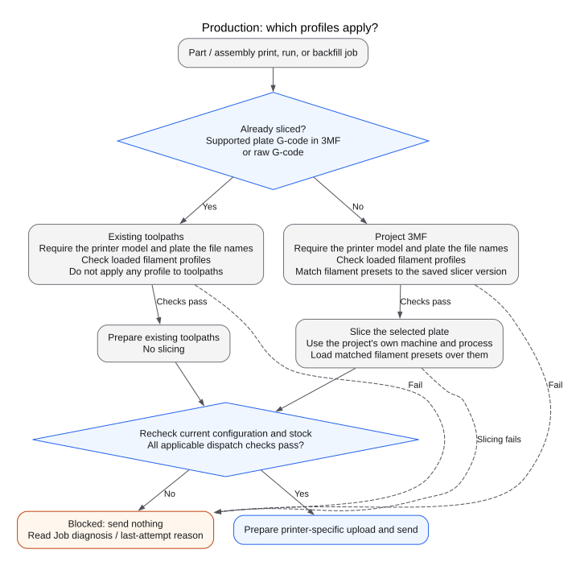

**A file carries its own machine, process, and plate.** OpenFarm does not choose them. A project 3MF needs slicing, and the slicer uses the settings saved in the project. Supported sliced 3MF and raw G-code already contain toolpaths. OpenFarm chooses only the filament profile for each spool, and checks that the file fits the destination printer.

There are two separate stages:

1. **Library processing** reads the uploaded file and, when supported, calculates estimates. It does not select settings from your connected printers or loaded spools.
2. **Production file preparation** checks the destination printer and its loaded spools. If slicing is needed, OpenFarm slices the project with its own settings and the part's saved slicer engine and exact version.

The saved engine and version are called the **slicer pin**. Pinning a job to a printer is a separate choice.

A successful estimate or **Ready to print** part does not guarantee that a particular printer can take the job. [Printer matching](../production/matching.md) still applies.

## What each profile means

| Profile | Where it comes from | Role when slicing |
| --- | --- | --- |
| **Printer / machine** | The project file. | Machine settings, including machine G-code and nozzle configuration. OpenFarm checks that the file names the destination printer's model, and checks the connected printer's nozzle report. |
| **Process** | The project file. | Layer height, walls, infill, and support settings. |
| **Filament** | Edit the filament → assign a profile for the printer brand, model, and nozzle size. A color can override this assignment. | Material settings for the tracked spool selected for each required material and color. |
| **Build plate** | The project file names its plate. Edit the printer to set the plate on its bed. | A job goes only to a printer whose plate matches the file's plate. |

A printer record describes physical hardware. A spool record tracks a physical roll of filament. A filament profile contains material settings for the slicer. Selecting a profile does not change the physical nozzle, plate, or material.

## Which kind of file did I upload?

The `.3mf` extension alone does not answer this question. A 3MF archive can contain geometry, project settings, or sliced toolpaths. A project can also retain geometry and settings after slicing.

| File contents | OpenFarm's route |
| --- | --- |
| **STL** | **Refused.** It carries no machine, process, or plate. |
| **Geometry-only 3MF** | **Refused.** It has no project settings. Save it as a project from OrcaSlicer or Bambu Studio. |
| **Project 3MF** | No supported plate G-code, but contains project settings; needs production slicing even if OpenFarm successfully estimates it. |
| **Sliced 3MF**, often named `.gcode.3mf` | Contains a supported `Metadata/plate_*.gcode` entry. OpenFarm treats the upload as already sliced, even if it also contains project settings and models. |
| **Raw `.gcode`, `.gco`, or `.g`** | Already sliced. |

OpenFarm looks inside the 3MF archive for supported plate G-code. The `.gcode.3mf` filename alone does not select the file's processing route. Other vendors' 3MF layouts are not automatically supported. OpenFarm can reject malformed or unsupported files. Unreadable or conflicting metadata can leave requirements or estimates unknown.

If an archive contains supported plate G-code, OpenFarm processes the upload as already sliced. This also applies to archives that mix sliced and unsliced plates. OpenFarm does not automatically slice the remaining plates. A requested plate must have usable sliced output.

For background on the format, Prusa's [Saving projects as 3MF](https://help.prusa3d.com/article/saving-projects-as-3mf_1773) explains why a project can carry settings and modifiers as well as geometry. OpenFarm's own supported entries determine its behavior.

## During upload, replacement, or reprocessing

**Library estimates do not use the fleet's selected machine and process profiles or the inventory's filament-profile assignments.** There is no separate farm estimation profile to configure.

| Uploaded file | Source of library time and weight estimates | Are production profiles applied? |
| --- | --- | --- |
| Supported unsliced project 3MF | OpenFarm first runs the selected slicer with the project's embedded settings. See the restricted retry below. | No; the destination printer and loaded spools are not selected here. |
| Sliced 3MF or raw G-code | Metadata already present in the file. OpenFarm does not run the slicer to recalculate it. | No. |

Missing time or weight stays unknown. It does not become zero. If an estimate fails, you can still save a part after reviewing its requirements. Production still needs complete requirements.

### Project settings and the named-preset retry

OpenFarm can estimate recognized OrcaSlicer and Bambu Studio projects from their embedded settings. The settings must be usable, and the selected slicer engine and version must be available. This estimation mode excludes Bambu Studio **2.7.1 on macOS**. It does not support Prusa or Cura project settings.

The first attempt loads the project without external machine, process, or filament preset files. A second attempt is available only for specific validation, version, or modified-machine errors. For this second attempt, OpenFarm:

1. Reads the machine, process, and filament preset names and the build plate stored in the project.
2. Looks up each preset by name in the **selected engine's exact version catalog**. Each name must have exactly one match.
3. Checks that the build plate is recognized and the matched presets are compatible.
4. Retries with those catalog presets.

This retry replaces the project's global preset settings. It does not reproduce custom edits to those presets. Project geometry and local settings remain inputs to the slicer.

The retry requires **one distinct nonblank filament preset name**. Several slots can share that name. A project with several different filament presets can succeed on the first attempt. It cannot use this retry.

Missing presets, multiple matches, or another slicing failure leave the estimate unavailable. This retry does not select your fleet's production profiles. Production dispatch does not use this retry as a fallback.

### Estimating does not make the source file pre-sliced

For an unsliced upload, the toolpath generated for estimation is temporary. OpenFarm saves the estimates and thumbnails, then discards that toolpath. It slices the stored source again when preparing a production job.

## When a job is prepared for a printer

Direct part printing, assembly printing, runs with fixed quantities, and continuous backfill all create queue work. They use the same file preparation and dispatch checks. Pinning a job restricts it to one printer. It does not bypass those checks.

### Project 3MF: generate a new production file

For each destination printer, OpenFarm:

1. Checks that the job's requirements are complete and current printer reports confirm the nozzle size.
2. Checks that the file names the destination printer's model and the plate on the printer's bed. A mismatch blocks the job.
3. Finds matching tracked spools on active feed paths.
4. Selects each spool's filament-profile assignment for that printer hardware and nozzle size. A color override takes priority over the filament default.
5. Requires the job's **exact slicer engine and version pin**.
6. Finds the compatible filament presets and their inherited settings in the pinned catalog.
7. Checks each required filament separately, including its bed-temperature setting for the file's plate.
8. Slices the part's selected project plate with the project's own machine and process settings. OpenFarm loads only the filament presets over them.
9. Rechecks the current configuration and stock before sending.

If a check or slicing fails, OpenFarm sends nothing. A profile constraint saved on a part or job must agree with the loaded spool's assignment. It cannot select a replacement preset. Spools in storage or on another printer are not fallbacks.

A project saved by a newer slicer than the pinned version can fail to slice. OpenFarm blocks the job. It does not substitute other presets.

| Setting source | Used to generate the production file? |
| --- | --- |
| The project's machine, process, and plate settings | **Yes.** They are the file's own settings. |
| Filament-profile assignments for the selected tracked spools | **Yes**, after matching and compatibility checks, for each required filament slot. They take priority over the project's filament presets. |
| Destination printer's selected build plate | **Checked, not applied.** The file's plate must equal it. |
| Project geometry, placement, painting, modifiers, and object or part settings | **Yes.** The slicer reads them from the project. |

The OrcaSlicer and Bambu Studio command-line interfaces (CLIs) give external filament presets priority over project-level filament settings. See the loading priority in the [OrcaSlicer 2.3.1 CLI implementation](https://github.com/OrcaSlicer/OrcaSlicer/blob/v2.3.1/src/OrcaSlicer.cpp#L6099-L6103) and [Bambu Studio 2.7.1 CLI implementation](https://github.com/bambulab/BambuStudio/blob/v02.07.01.57/src/BambuStudio.cpp#L8257-L8260).

For multi-color projects, OpenFarm matches each project slot to a job line by its detected material and color. It loads the matched filament profile for each slot, in slot order. A slot known to be unused on that plate needs no separate job line.

If a used slot has no match, OpenFarm blocks the job. It does not keep an embedded filament preset as a substitute.

Production profile matching supports **OrcaSlicer and Bambu Studio**. A SuperSlicer CLI adapter exists in the code, but it does not support these profile catalogs. It cannot bypass a missing or incompatible profile.

### Sliced 3MF and raw G-code: keep the existing toolpaths

OpenFarm does **not** re-slice these files or apply any profile to their toolpaths.

| Configuration | What happens for an already-sliced job? |
| --- | --- |
| Machine and process | **Not used.** The toolpaths keep the settings of the original slice. |
| Filament-profile assignments | **Required and validated** for the loaded, tracked spools. OpenFarm checks material, nozzle, and saved profile constraints. It does not replace toolpath settings such as temperature, flow, or cooling. |
| Build plate | **Checked.** The file must name the plate on the destination printer's bed. A different or missing plate blocks the job. |
| Part's slicer pin | No slicer is run. OpenFarm does not look up these validation assignments in a pinned slicer catalog. |

For real supported printers, the file must declare a recognizable **target printer model matching the destination**, and the **plate on the printer's bed**. A missing or unrecognized model or plate, a different model, or a different plate blocks the job. These checks do not apply to the simulator. They apply to project 3MF files too.

Entering a missing nozzle or material requirement manually does not add a missing printer-model or plate declaration to the file.

Temperatures, speeds, layer height, supports, and other toolpath choices remain those of the original slice. Choosing another spool color changes which physical stock can match the job. It does not rewrite the file's slicing settings.

:::note Existing toolpaths can still need execution preparation
OpenFarm can still prepare the file for a partial plate or supported object skipping. It can also package or adapt the file for the printer's protocol. The uploaded bytes can therefore differ from the stored file. These operations do not apply slicing profiles. See [Outcomes and recovery](../production/outcomes.md).
:::

### Original downloads, job downloads, and printer-started prints

Downloading a **part's original file** returns the stored upload without applying profiles. It does not export the temporary library-estimation result.

A **job file** download returns the file saved for that job, if available. Otherwise, OpenFarm prepares a production file as described above. This requires an assigned or pinned target printer. Downloading a saved job file does not slice it again with today's profiles.

OpenFarm can observe a print started outside its queue. This is a printer-started print. Observing it does not cause OpenFarm to slice it or apply profile settings.

## Which version of a profile is used?

This section applies when OpenFarm **slices** a production file. It concerns the filament profile, the only profile OpenFarm resolves. A selected profile can come from a different catalog than the part's pinned slicer:

| Saved choice | Resolution for production slicing |
| --- | --- |
| System preset already in the pinned engine and version | Use that preset. |
| System preset from another version of the same engine | Find a match by vendor and external preset ID. A renamed preset can match. Without an ID, use vendor and name. |
| System preset from the other supported engine | Require an exact match by external ID, vendor, and name. A similar display name is insufficient. |
| User preset made for the pinned engine | Use the user preset. Match its inherited system presets to the pinned catalog. |
| User preset from another engine | Block. |

OpenFarm blocks slicing if a preset is missing, has multiple matches, or is incompatible. It also blocks missing catalogs, unavailable slicers, and inherited presets or templates that it cannot load. It does not substitute a similar preset, another engine, or a newer version.

## What happens after I change something?

| Change | Effect |
| --- | --- |
| Change the farm default slicer | Changes the default for new processing and the catalog shown in profile lists. Existing parts and jobs keep their pins. |
| Replace or reprocess a project 3MF | Keeps its current pin unless you choose another slicer. A part without a pin can use the farm default. Reads requirements and estimates again using the applicable route above. |
| Reprocess a sliced file | Reads its metadata again. Does not regenerate toolpaths with your current profiles. |
| Change the printer's build plate, or a filament assignment | OpenFarm checks the new configuration on the next production preparation, according to the file route. Saved library estimates stay unchanged. |
| Change settings or loaded spools while a file is being generated | Dispatch checks fresh state again. A configuration mismatch stops the send and leaves the job for retry. |
| Edit a library part after jobs with fixed quantities were queued | Those jobs keep their saved source inputs and pin. OpenFarm still checks current printer settings and spool assignments. Continuous backfill can use the updated part before dispatch. |

- **To keep an external slicer's toolpaths**, upload its supported sliced output.
- **To have OpenFarm slice for you**, upload a project 3MF. It uses the project's own machine and process settings.

Either route still needs a file made for the destination printer's model and plate, and compatible hardware, material, and filament configuration.
